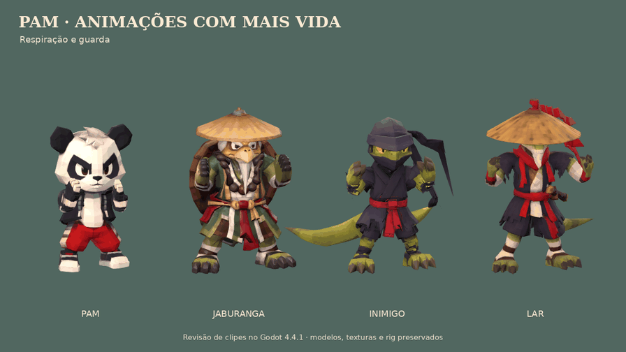

# Movimento, dano e mortes

O Pam agora tem **21 clipes**, e cada NPC tem **20**. A revisão acrescenta respiração e balanço na guarda, movimento de tronco/cabeça/braços na corrida, subida, queda, aterrissagem, reações de dano e variantes de morte. Os modelos, texturas, pesos e repousos fornecidos foram preservados.



[Vídeo](captures/animacoes-vivas.mp4) · [Pulo na fase](captures/movimento-pulo-na-fase.png) · [Dano na fase](captures/movimento-dano-na-fase.png) · [Mortes na fase](captures/movimento-mortes-na-fase.png).

## Integração

- `Rise` acompanha a subida física, `Fall` entra no ápice e `Land` comprime o corpo ao tocar o chão. A entrada de pulo permanece imediata. `Jump` é a demonstração do arco completo na cena de revisão; seu deslocamento visual não é acrescentado à física do jogador. `JumpStart` registra a preparação para autoria/revisão.
- `Hit` e `HitHeavy` usam recuo do tronco, desequilíbrio, braços e cabeça com atraso e recuperação. A reação inicial do Pam fica visível antes do piscar de invulnerabilidade.
- Pam permanece visível ao morrer, perde o controle e limpa o combo. `Death` mostra a queda e o repouso; `DeathFall` trata o vazio. O jogo espera 1,3 s antes do escurecimento e mais 0,25 s antes do reaparecimento no checkpoint. A derrota obrigatória também usa o esqueleto.
- Inimigos usam `Defeat` após golpes comuns, `DeathBack` após golpes fortes e `DeathFall` no vazio. A gravidade, as colisões e o impulso continuam durante a derrota. O clipe termina, o corpo repousa e então afunda e é removido. As caudas contrabalançam a queda.
- A velocidade da corrida dos ninjas acompanha seu movimento; a respiração tem fases diferentes entre instâncias. Caudas e fitas recebem movimento secundário. Subida/queda/aterrissagem também tratam deslocamentos verticais dos NPCs; isso não acrescenta uma IA de salto.

Os controles continuam **J/X: giro → médio → forte** e **Espaço/A: pulo**. Os canais dos golpes de Pam permanecem idênticos aos anteriores, mantendo o alcance e a correção das mãos.

## Revisar e reproduzir

Abra `scenes/pam_combat_review.tscn` com F6: **5** pulo, **6** dano, **7** morte, **8** queda, **9** corrida. Os atalhos 1–4 continuam revisando o combo. Espaço pausa, setas avançam/voltam um quadro, V muda a vista e 0 retorna à T-pose.

Na cena `scenes/npc_rig_review.tscn`, os atalhos existentes continuam ativos; **H** mostra dano forte, **J** pulo, **F** queda, **L** aterrissagem e **D** derrota para trás. B mostra os ossos.

`tools/motion/animate.py` grava os movimentos nos `.blend` distribuídos, preservando ações de base para permitir repetir o comando sem acumular alterações. Os pés de apoio são resolvidos na autoria; o repouso de morte usa o chão da malha deformada. `merge.py` transfere somente os canais de animação aos GLBs, preservando o prefixo binário original e as estruturas de malha, skin, nós, materiais e imagens.

```sh
blender -b -t 4 --python-exit-code 1 -P tools/motion/animate.py -- pam
blender -b -t 4 --python-exit-code 1 -P tools/motion/animate.py -- januri
blender -b -t 4 --python-exit-code 1 -P tools/motion/animate.py -- inimigo
blender -b -t 4 --python-exit-code 1 -P tools/motion/animate.py -- lar
./tools/godot.sh --headless --editor --import
./tools/godot.sh --headless --script tools/motion/review.gd -- --validate-only
./tools/godot.sh --headless --fixed-fps 120 --script tests/animation_states.gd
./tools/godot.sh --headless --fixed-fps 30 --script tests/animation_states.gd
PAM_REVIEW_SCRIPT=tools/motion/review.gd ./tools/render_review.sh
PAM_REVIEW_SCRIPT=tools/motion/capture_game.gd ./tools/render_review.sh --fixed-fps 30
python3 tools/motion/compose.py
```

As saídas vão para `build/motion_review/`; `PAM_MOTION_OUTPUT` permite escolher outra pasta. A verificação de preservação em `tools/motion/verify.py` compara os GLBs anteriores guardados em `build/motion_baseline/{pam,januri,inimigo,lar}.glb` com os novos. Nesta revisão, a base corresponde ao commit `4f2f177`. Ao regenerar os rigs pelos autores anteriores, aplique este passe de animação por último. Blender 4.3.2 é ferramenta de autoria; o jogo continua independente de Blender/plugins.

## Testes executados

No **Godot 4.4.1**:

- Estados de animação: **18/18 em 120 FPS e 18/18 em 30 FPS**, usando os controladores reais para pulo, colisão de aterrissagem, dano, morte, bloqueio de entradas, reaparecimento e remoção tardia do inimigo.
- Integração: **35/35**. Combate: **20/20 em cada taxa**. Travessia integral em ambas: conclusão, **0 mortes, 6 inimigos derrotados**, checkpoint e portão.
- Clipes nos quatro esqueletos: poses fracionárias finitas; compressão de aterrissagem de aproximadamente 0,071–0,085 m, rotação de reação da cabeça de 21° e colapso de 88°.
- Arte/skin preservadas nos quatro GLBs; canais protegidos dos golpes do Pam idênticos; geometria, UVs, normais e pixels PBR dos NPCs conferidos. As mãos de Pam continuam sem mistura de pesos nos dedos e com anisotropia máxima inferior a 1,04. O soco forte mantém alcance maior que o médio.
- Fontes Blender dos NPCs reabertas com os clipes e texturas empacotadas; controles da revisão do Pam executados.

Logs em `docs/test-logs/motion-*`; relatórios em `docs/captures/movimento-*-verificacao.json`. A prévia mostra clipes reais no motor; as imagens da fase são capturas preparadas com os métodos reais do controlador. Não representam uma sessão manual. O renderizador foi Mesa llvmpipe por software, sem avaliação manual com controle ou medição em GPU dedicada. A importação headless pode emitir o diagnóstico interno de textura do renderizador dummy. O runner da captura da fase registrou um aviso de objetos pendentes ao encerrar; o log acompanha a entrega.

Ainda não há rig facial, controle individual dos dedos, simulação de tecido ou ragdoll. As derrotas usam animações de esqueleto com física no controlador; contato visual com paredes e pesos de roupas em poses extremas podem precisar de refinamento artístico.
