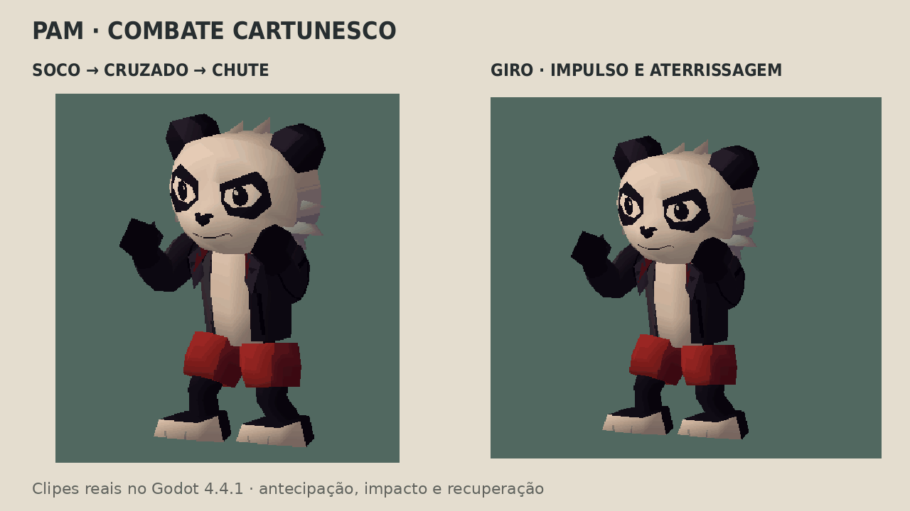
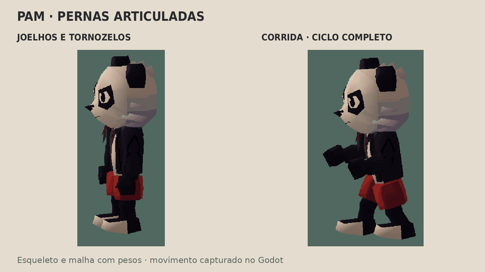
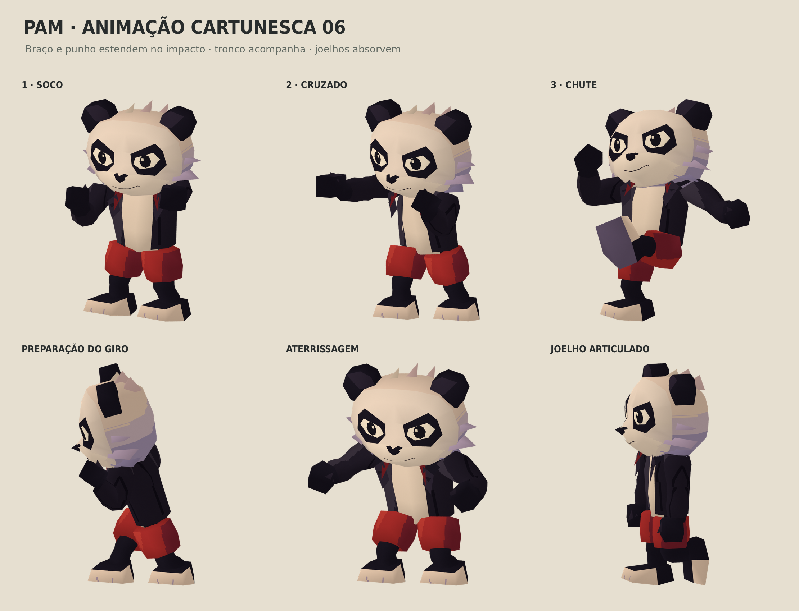

# Pam — animação cartunesca, revisão 06

**Continuação:** os movimentos desta revisão foram adaptados ao [modelo fornecido pelo usuário](MODELO_USUARIO.md), que substitui este estudo como referência visual do Pam.

O pedido desta revisão é dar mais vida ao combate: braço e punho estendem brevemente no impacto, o corpo prepara e acompanha os golpes, e joelhos/tornozelos participam da base, corrida, chute e aterrissagem.







## Arquivo e movimento

`assets/models/pam_ps1_cartoon.glb` contém **22 ossos**, uma malha com pesos, **1.131 triângulos**, um material, atlas original 128×128 e uma forma de piscada. A fonte está em `assets/source/pam_ps1_cartoon.blend`; contagens e parâmetros em `pam_ps1_cartoon_metadata.json`. O elo de pelo no pescoço cobre a região sob a gola durante as novas inclinações.

Os nove clipes são `Guard`, `Jab`, `Cross`, `Kick`, `Combo`, `Spin`, `Run`, `ElbowFlex` e `KneeFlex`. O combo encadeia soco direito, cruzado esquerdo e chute, com preparação, impacto sustentado por dois ou três quadros, movimento após o impacto e recuperação. A cabeça reage depois do tronco, as mãos recuperam com balanço e a guarda tem respiração e uma piscada.

O importador do Godot configura `Guard` e `Run` para repetição; golpes e giro terminam normalmente. Esses modos também foram conferidos após a importação.

No impacto do soco, as escalas locais chegam a **1,035** no eixo longitudinal do braço, **1,095** no antebraço e **1,12 / 1,06 / 1,10** no punho. Voltam ao valor 1 na recuperação. Esses fatores são locais: escalas herdadas dos ossos pais também afetam a silhueta. O esticamento está nos clipes reais do GLB.

O giro prepara agachado, abre os braços, completa **720°**, alterna a posição das pernas durante o impulso e aterrissa com flexão dos joelhos. Não é apenas uma rotação de um corpo rígido em pose fixa.

A base de luta e a perna de apoio usam solução de IK de dois segmentos durante a autoria, gravada nos ossos a cada quadro. O quadril abaixa quando necessário para manter o pé ao alcance da perna. O chute levanta, estende e recolhe a outra perna. A corrida tem ciclo alternado de apoio e passagem do pé. `KneeFlex` demonstra separadamente as duas cadeias coxa → canela → pé → ponta do pé. O arquivo de execução só usa ossos, escalas e morph padrão glTF; não requer plugin ou solver externo. Não há controles IK interativos adicionados à fonte.

## Verificação executada

No **Godot 4.4.1**, o arquivo foi importado com os nove clipes disponíveis no `AnimationPlayer`. Os clipes de combate, guarda, corrida e flexão dos joelhos foram reproduzidos na revisão. O teste verificou material/atlas, skin e hierarquia dos ossos; mediu **90° em cada joelho** com a coxa imóvel; conferiu as escalas de impacto e seu retorno a 1; acumulou **720° no giro**; e confirmou abertura/fechamento da piscada exportada.

Nas amostras de apoio dos clipes `Jab`, `Cross` e `Kick`, o maior deslocamento medido na origem do osso do pé de apoio foi **0,00021 unidades**. Essa medição cobre os instantes de teste registrados no script, não uma prova de ausência de deslizamento em todas as poses. A primeira versão revelou falta de alcance no apoio do cruzado; o ajuste do quadril corrigiu esse caso e a verificação foi repetida.

Foram gravados **245 quadros reais de 640×480**, com todos os ossos em posições finitas. Os GIFs usam essas capturas, com paleta compartilhada e duração correspondente a 30 quadros/s. Os renders da prancha também importam o GLB exportado. Não há pintura do personagem sobre as imagens. Relatório em `docs/captures/pam-cartoon-06-verificacao.json`.

A importação headless termina com código 0 e mantém o diagnóstico interno de textura `Parameter "t" is null` do renderizador dummy. A revisão gráfica OpenGL/llvmpipe concluiu com `PAM_CARTOON_CHECKS_OK` e `PAM_CARTOON_GODOT_OK`, sem erro de script. A indisponibilidade do Draco é registrada pelo Blender; o arquivo usa geometria sem essa compressão.

## Reproduzir e limites

```sh
blender -b -t 4 -P tools/ps1/cartoon.py
./tools/godot.sh --headless --editor --import
blender -b -t 4 -P tools/ps1/render_cartoon.py
PAM_REVIEW_SCRIPT=tools/ps1/review_cartoon.gd ./tools/render_review.sh
python3 tools/ps1/compose_cartoon.py
```

O gerador usa a fonte da revisão 05, que pode ser refeita com `tools/ps1/rig.py`. Blender 4.3.2, Python/Pillow e o Godot fixado no projeto são ferramentas de autoria; o GLB já está incluído.

Este é um estudo de animação em avaliação visual, separado do personagem ativo na Fase 1. Ainda é necessário adaptar o animador procedural do jogo aos novos clipes e sincronizar os quadros de contato com os hitboxes. Nenhum teste de gameplay foi repetido nesta revisão, pois o controlador e o modelo ativo não mudaram. Não há novos clipes de forte, ataque aéreo ou esquiva, nem rig facial completo, dedos individuais ou aprovação artística presumida. Todos os movimentos e assets são originais; não foram usados dados comerciais de animação do Crash.
