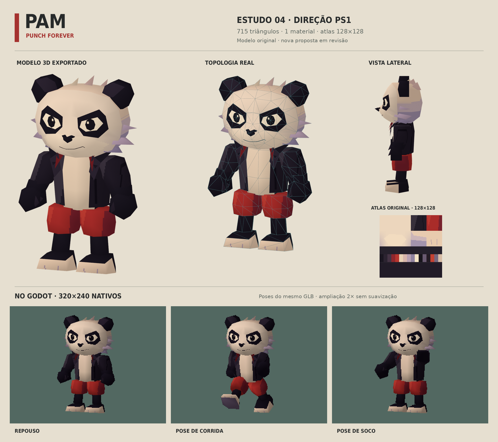

# Pam — estudo técnico PS1, revisão 04

**Histórico:** este estudo tinha somente pivôs rígidos, sem cotovelos. Foi sucedido pelo [rig da revisão 05](RIG_PAM.md), com esqueleto, pesos e clipes reais. Os arquivos desta revisão permanecem como fonte da cabeça/roupa e registro do processo.

Referência escolhida pelo usuário: a construção visual dos modelos de Crash 1 no PS1. A aprovação anterior dos personagens foi retirada. Este estudo original mantém Pam como filhote de panda de jaqueta preta e bermuda vermelha, com silhueta compacta, orelhas poligonais, olhos definidos na malha, mãos fechadas e proporções legíveis em baixa resolução.



## Arquivo real

- `assets/models/pam_ps1_estudo.glb`: **715 triângulos**, um material, cores por vértice e um atlas **128×128** com filtro nearest.
- `assets/source/pam_ps1_estudo.blend`: fonte editável.
- `assets/textures/pam_ps1_atlas.png`: pintura original; sem texturas comerciais.
- Pivôs `Head`, `Torso`, `ArmL`, `ArmR`, `LegL`, `LegR` para poses. Não há novos clipes finais de animação.
- O modelo está separado de `pam.glb`, atualmente usado pela fase. A nova direção ainda aguarda avaliação visual antes de ser aplicada ao elenco.

O orçamento e as proporções são escolhas desta autoria. Os anexos disponíveis tratam de física/colisão e do mapa mestre; o mapa deixa geometria, animação e renderização pendentes. Não contêm uma malha original, contagens de polígonos recuperadas ou dados suficientes para reconstruir os modelos comerciais. A iluminação por vértice e o material unlit são uma aproximação visual original em glTF/Godot, não emulação do pipeline de hardware PS1.

## Verificação

A importação foi executada no Godot 4.4.1. A revisão gráfica carrega o GLB exportado, verifica o material unlit, uso das cores por vértice, atlas 128×128 e seis pivôs. Grava poses de repouso, corrida e soco em SubViewport **320×240** sem antialiasing. Os quadros ampliados da prancha usam pixels inteiros, sem retoque do personagem. O render maior e a topologia também vêm do GLB importado no Blender, sem malha alternativa.

A importação headless terminou com código 0 e registrou o diagnóstico interno `Parameter "t" is null` do renderizador dummy, já observado nos outros GLB. A revisão com renderizador OpenGL por software concluiu as três capturas e verificações (`PS1_REVIEW_OK`), sem erro de script. Não se trata de uma execução sem diagnósticos de engine.

Essas capturas verificam importação, materiais e poses; não constituem novo teste de gameplay, aprovação artística nem validação em hardware PS1. A fase não foi alterada nesta revisão.

## Reproduzir

```sh
python3 tools/ps1/paint_atlas.py
blender -b -t 4 -P tools/ps1/model.py
./tools/godot.sh --headless --editor --import
blender -b -t 4 -P tools/ps1/render.py
PAM_REVIEW_SCRIPT=tools/ps1/review.gd ./tools/render_review.sh
python3 tools/ps1/compose.py
```

As ferramentas de autoria usam Blender 4.3.2, Python/Pillow e o Godot 4.4.1 fixado no projeto. Não são plugins de execução.
