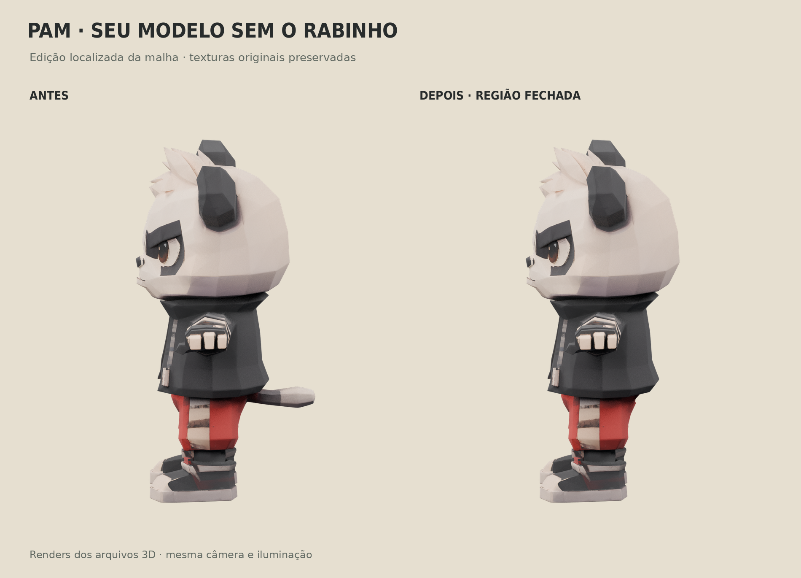
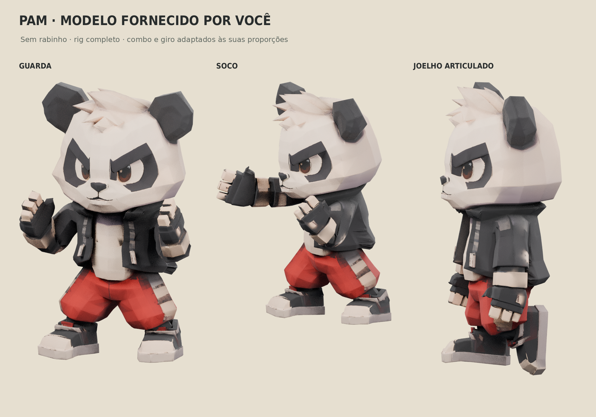
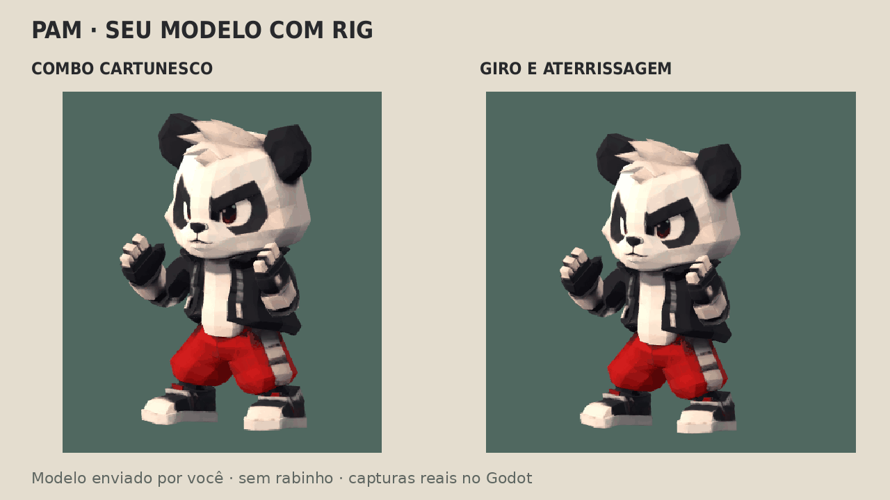
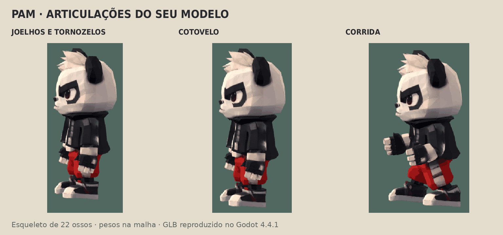

# Pam — modelo fornecido pelo usuário, sem rabo e com rig

O usuário enviou `5d3ee866736f057f78c3c146b673b7a2.glb` em T-pose e pediu a remoção do rabinho e aplicação do rig. Esse modelo substitui os estudos visuais anteriores como base do Pam. A autoria do visual e das texturas é do material fornecido pelo usuário; a edição, pesos e adaptação das animações foram feitos neste projeto.









## Arquivos

- `assets/source/pam_usuario_original.glb`: entrada intacta; SHA-256 `293e2e7f4ed41c0280ef04bdcc710dca75407fcf6e72a4f9b1f9fb3bd1f469b2`.
- `assets/models/pam_usuario_sem_rabo.glb`: T-pose na escala original, com a reparação localizada e os materiais PBR originais.
- `assets/models/pam_usuario_rig.glb`: a mesma edição, com esqueleto, pesos e nove clipes. A cópia para animação foi escalada uniformemente para 1,6 unidades de altura; fator **1,538545716**. Isso adapta a escala de trabalho, sem alterar as proporções.
- `assets/source/pam_usuario_rig.blend`: fonte editável, armature em T-pose e ações `PamUser_*`. O armature auxiliar `AnimationSource` está oculto e conserva a referência dos movimentos; ele não é exportado no GLB.
- `assets/source/pam_usuario_edicao.json` e `pam_usuario_rig_metadata.json`: registro da edição e do rig.

## Remoção do rabinho

O arquivo chegou como uma única superfície conectada, com 50.004 triângulos. A edição identifica o rabo conectado atrás da bermuda, remove 1.006 faces e fecha a região com 972 faces que seguem o contorno das costas/roupa. A versão resultante tem **49.970 triângulos**, sem arestas de borda e com superfície manifold. Os vértices coincidentes das costuras foram unidos, preservando UVs e normais por canto.

A checagem geométrica confirmou a preservação das posições na cabeça/parte superior do corpo fora da área da edição. O fechamento usa amostras do tecido original na região traseira. A comparação dos pixels confirmou identidade nos mapas de cor e normal e nos canais de rugosidade/metallic usados pelo material. As imagens **4096×4096** permanecem embutidas nos GLBs.

## Rig e animação

O rig tem **22 ossos**: raiz, quadril, coluna, peito, pescoço, cabeça; clavículas, braços, antebraços e mãos; coxas, canelas, pés e pontas dos pés. Pesos automáticos foram ajustados para proteger o rosto, luvas e calçados, limitados a quatro influências e normalizados. Nenhum vértice ficou sem peso na vinculação automática.

Os clipes `Guard`, `Jab`, `Cross`, `Kick`, `Combo`, `Spin`, `Run`, `ElbowFlex` e `KneeFlex` foram adaptados da animação original da revisão 06. A conversão trata a diferença entre a T-pose nova e o repouso de braços baixos do estudo anterior, calibra a rotação das mangas/luvas e recalcula o apoio das pernas conforme os novos comprimentos. O esticamento cartunesco do antebraço/punho permanece no impacto, seguido da recuperação.

O rig é FK na execução; o apoio de pés é resolvido e gravado na autoria. Não há dedos individuais nem novas formas faciais. A piscada do estudo anterior não foi transferida à malha do usuário. Em Blender, selecione `PamRig` e escolha uma ação `PamUser_*` no Action Editor para reproduzir os movimentos; a posição de repouso permanece em T.

## Verificação executada

No **Godot 4.4.1**, foram verificados skin, 22 ossos, nove clipes, material PBR e texturas 4K. A geometria de repouso confirmou a ausência do rabo. Cotovelo direito e ambos os joelhos chegaram a aproximadamente **90°** sem mover o segmento superior no teste isolado. O giro acumulou **720°**. As escalas de impacto foram reproduzidas e a escala do antebraço voltou a 1 na recuperação.

O maior deslocamento do osso do pé de apoio nas amostras dos golpes foi **0,00019 unidades**. Foram gravados **264 quadros reais de 640×480**, com MSAA 2×, material fornecido e iluminação de revisão. A malha das prévias é o próprio GLB exportado. Relatório em `docs/captures/pam-usuario-verificacao.json`.

Uma segunda importação foi feita em um projeto limpo, contendo apenas os dois GLBs e um `project.godot` mínimo. Ambos carregaram material, cor, normal e rugosidade; o rig carregou os ossos e os clipes esperados. Assim, as versões distribuídas não dependem dos PNGs que o Godot extrai automaticamente ao importar os GLBs. Esses PNGs gerados estão ignorados no Git.

A importação headless retorna código 0, mantendo o diagnóstico interno `Parameter "t" is null` do renderizador dummy. A revisão gráfica terminou com `PAM_USER_MODEL_CHECKS_OK` e `PAM_USER_MODEL_GODOT_OK`, sem erro de script. O Blender registra Draco indisponível e aviso de sampler compartilhado ao exportar a textura packed; o arquivo usa geometria sem Draco e os pixels dos mapas foram conferidos.

## Reproduzir e continuar

```sh
blender -b -t 4 -P tools/user_model/remove_tail.py
blender -b -t 4 -P tools/user_model/rig.py
./tools/godot.sh --headless --editor --import
PAM_USER_RENDER_ORIGINAL=1 blender -b -t 4 -P tools/user_model/render_tail.py
blender -b -t 4 -P tools/user_model/render_tail.py
blender -b -t 4 -P tools/user_model/render_rig.py
PAM_REVIEW_SCRIPT=tools/user_model/review.gd ./tools/render_review.sh
python3 tools/user_model/compose.py
```

O `.blend` intermediário da reparação é gerado pelo primeiro comando e não precisa ser distribuído; o original, a fonte final com rig e os GLBs já acompanham o projeto. Ferramentas: Blender 4.3.2, Python/Pillow e Godot 4.4.1. Não há plugin externo para execução.

O novo modelo está separado do personagem ativo da Fase 1. Adaptar o controlador de animação e sincronizar os contatos/hitboxes com os clipes continua como próximo trabalho de integração. Os testes desta revisão cobrem o asset, importação e animação; não houve novo teste de percurso, de desempenho em GPU ou de conforto de gameplay. Deformações extremas da roupa e qualidade artística ainda podem precisar de ajustes após revisão visual.
