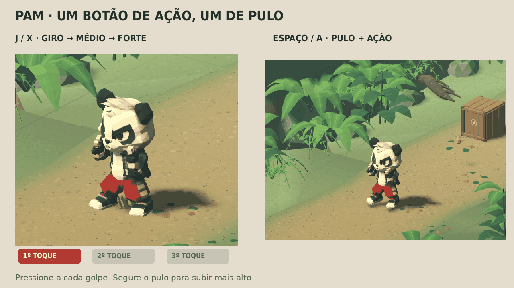

# Pam — modelo fornecido pelo usuário, sem rabo e com rig

O usuário enviou `5d3ee866736f057f78c3c146b673b7a2.glb` em T-pose e pediu a remoção do rabinho e aplicação do rig. Esse modelo substitui os estudos visuais anteriores como base do Pam. A autoria do visual e das texturas é do material fornecido pelo usuário; a edição, pesos e adaptação das animações foram feitos neste projeto.





## Arquivos

- `assets/source/pam_usuario_original.glb`: entrada intacta; SHA-256 `293e2e7f4ed41c0280ef04bdcc710dca75407fcf6e72a4f9b1f9fb3bd1f469b2`.
- `assets/models/pam_usuario_sem_rabo.glb`: T-pose na escala original, com a reparação localizada e os materiais PBR originais.
- `assets/models/pam_usuario_rig.glb`: a mesma edição, com esqueleto, pesos e nove clipes. A cópia para animação foi escalada uniformemente para 1,6 unidades de altura; fator **1,538545716**. Isso adapta a escala de trabalho, sem alterar as proporções.
- `assets/source/pam_usuario_rig.blend`: fonte editável, armature em T-pose e ações `PamUser_*`. O armature auxiliar `AnimationSource` está oculto e conserva a referência dos movimentos; ele não é exportado no GLB.
- `assets/source/pam_usuario_edicao.json` e `pam_usuario_rig_metadata.json`: registro da edição e do rig.

## Remoção do rabinho

O arquivo chegou como uma única superfície conectada, com 50.004 triângulos. A edição identifica o rabo conectado atrás da bermuda, remove 1.006 faces e fecha a região com 972 faces que seguem o contorno das costas/roupa. A versão resultante tem **49.970 triângulos**, sem arestas de borda e com superfície manifold. Os vértices coincidentes das costuras foram unidos, preservando UVs e normais por canto.

A checagem geométrica confirmou a preservação das posições na cabeça/parte superior do corpo fora da área da edição. O fechamento usa amostras do tecido original na região traseira. A comparação dos pixels confirmou identidade nos mapas de cor e normal e nos canais de rugosidade/metallic usados pelo material. As imagens **4096×4096** permanecem embutidas nos GLBs.

## Rig e animação

O rig tem **22 ossos**: raiz, quadril, coluna, peito, pescoço, cabeça; clavículas, braços, antebraços e mãos; coxas, canelas, pés e pontas dos pés. Pesos automáticos foram ajustados para proteger o rosto, luvas e calçados, limitados a quatro influências e normalizados. Nenhum vértice ficou sem peso na vinculação automática.

Os clipes `Guard`, `Jab`, `Cross`, `Kick`, `Combo`, `Spin`, `Run`, `ElbowFlex` e `KneeFlex` foram adaptados da animação original da revisão 06. A conversão trata a diferença entre a T-pose nova e o repouso de braços baixos do estudo anterior, calibra a rotação das mangas/luvas e recalcula o apoio das pernas conforme os novos comprimentos. O esticamento cartunesco do antebraço/punho permanece no impacto, seguido da recuperação.

O rig é FK na execução; o apoio de pés é resolvido e gravado na autoria. Não há ossos individuais para os dedos nem novas formas faciais. A piscada do estudo anterior não foi transferida à malha do usuário. Em Blender, selecione `PamRig` e escolha uma ação `PamUser_*` no Action Editor para reproduzir os movimentos; a posição de repouso permanece em T.

## Integração jogável — revisão 4

O modelo agora é o Pam ativo da Fase 1, com um botão de ação e um de pulo: **giro → soco médio → soco forte de longo alcance**. J / X encadeia os golpes; Espaço / A pula. As colisões seguem os punhos do esqueleto na física, com varredura e bloqueio por paredes. O GLB contém 12 clipes, incluindo os novos `Medium`, `Strong`, `Jump` e o `Combo` recomposto. Detalhes, controles e verificações atuais em [COMBATE_DOIS_BOTOES.md](COMBATE_DOIS_BOTOES.md).

As seções abaixo registram as revisões anteriores de vinculação e animação. A antiga separação entre modelo e fase foi resolvida nesta revisão.

## Mãos corrigidas e alcance — revisão 3 (histórico)

A passagem do punho tinha pesos de antebraço misturados à mão; o escalonamento herdado também podia deformar a forma dos dedos durante a rotação. Os 1.409 vértices da região de mãos/polegares em Blender agora seguem integralmente o osso da mão, com uma transição estreita no punho. A malha exportada tem 1.960 vértices nessa região, contando as divisões de UV/normal. Não houve alteração da escultura dos dedos, geometria de repouso, normais, UVs, índices, matrizes de vínculo ou imagens PBR; a comparação binária dos dois GLBs confirmou esses invariantes. Os pesos foram corrigidos localmente.

O punho acompanha a orientação do antebraço, com flexão controlada e alinhamento no impacto. A escala herdada foi tratada para evitar cisalhamento da mão. A razão entre os fatores principais de deformação da mão caiu de 1,124 na revisão anterior para 1,022 no pior caso da nova revisão, incluindo amostras entre quadros. Isso preserva melhor a forma dos dedos enquanto a mão aumenta discretamente.

O soco agora combina extensão temporária do braço e avanço do ombro. O comprimento do antebraço chega a 1,25 no impacto, e a mão conserva o aumento discreto de 1,135. A extensão radial do giro também aumentou. Medindo os vértices deformados contra a revisão `e11aebb`: jab **+19,1%** de alcance frontal, cruzado **+18,6%**, giro **+11,1%** de alcance radial e chute **+2,4%**. São medidas da animação do modelo; as hitboxes da fase não foram ampliadas nesta revisão. A geometria e as proporções em T-pose permanecem idênticas, e as escalas recuperam os valores de guarda após o golpe ou interrupção.

[Comparação do alcance](captures/pam-usuario-alcance-v3.png) · [Detalhes das mãos](captures/pam-usuario-maos-v3.png) · [Prévia animada](captures/pam-usuario-cartoon-v3.gif) · [Vídeo](captures/pam-usuario-cartoon-v3.mp4).

Foram gravadas 266 capturas reais no Godot 4.4.1. A revisão verifica os pesos das mãos importadas, extensão do antebraço, estabilidade da forma da mão em tempos fracionários, recuperação da escala, articulações, apoio de pés e término dos efeitos. O relatório está em `docs/captures/pam-usuario-cartoon-v3-verificacao.json`. As medições da malha e das mãos são feitas por `tools/user_model/check_hands.py`; `check_bind.py` compara as duas versões do GLB. A validação da Fase 1 não foi refeita, pois o novo modelo continua na cena de revisão, separado do controlador ativo.

## Combate cartunesco — revisão 2 (histórico)

Os socos foram refeitos com alvos de punho e polos de cotovelo nas proporções deste modelo. O combo encadeia antecipação, jab, cruzado e chute, com mudanças de peso, recuperação dos braços e dobra do joelho. O giro mantém duas voltas com abertura dos braços, contração inicial e aterrissagem. O comprimento do antebraço chega ao fator autoral 1,135 e a mão a 1,135 no impacto; o giro usa fatores menores. A perna do chute recebe esticamento breve. Esses valores são animação, **sem mudar a malha, os pesos ou o repouso em T-pose**.

A comparação binária com o GLB anterior confirmou identidade de `POSITION`, `NORMAL`, `TEXCOORD_0`, `JOINTS_0` e `WEIGHTS_0`, além das três imagens PBR embutidas. A fonte Blender também verifica uma impressão digital das posições, pesos e matrizes de repouso antes e depois da autoria.

Abra **`scenes/pam_combat_review.tscn` e pressione F6** para ver o modelo e os efeitos no motor. Teclas 1–5 selecionam combo, giro, soco, cruzado e chute; Espaço pausa; setas avançam ou recuam um quadro; V muda a câmera; 0 mostra a T-pose original. Os pequenos rastros e acentos são malhas geradas por `scripts/combat_flourish.gd`, ligados ao tempo e às posições dos punhos/pé. Pausar, reiniciar ou interromper o golpe limpa os efeitos corretamente. Os rastros seguem as direções da T-pose através das matrizes de repouso, sem depender do eixo interno escolhido na importação do esqueleto.

**Os efeitos estão na cena Godot e não dentro do GLB.** Os acentos da revisão são marcadores visuais da coreografia, sem causar dano ou comprovar contato com inimigos. A sincronização com hitboxes do personagem ativo da fase continua pendente.

A revisão foi executada no Godot 4.4.1: 264 capturas reais, poses fracionárias finitas, retorno da escala de todos os membros de ataque à guarda e interrupção do giro sem deformação residual. O maior erro de escala na recuperação foi inferior a 0,000001; a deriva amostrada dos pés de apoio foi 0,00019 unidades. Foram verificados o aparecimento e o término dos efeitos. A cena de revisão também passou no teste de reprodução, pausa, avanço/retorno de quadro, troca de clipe, câmera e retorno à T-pose, com `--fixed-fps 30` e `--fixed-fps 120`; isso verifica a execução e não mede desempenho em GPU. Relatório: `docs/captures/pam-usuario-cartoon-v2-verificacao.json`. [Vídeo MP4](captures/pam-usuario-cartoon-v2.mp4) e [prévia GIF](captures/pam-usuario-cartoon-v2.gif).

## Verificação da vinculação inicial

No **Godot 4.4.1**, foram verificados skin, 22 ossos, nove clipes, material PBR e texturas 4K. A geometria de repouso confirmou a ausência do rabo. Cotovelo direito e ambos os joelhos chegaram a aproximadamente **90°** sem mover o segmento superior no teste isolado. O giro acumulou **720°**. As escalas de impacto foram reproduzidas e a escala do antebraço voltou a 1 na recuperação.

O maior deslocamento do osso do pé de apoio nas amostras dos golpes foi **0,00019 unidades**. Foram gravados **264 quadros reais de 640×480**, com MSAA 2×, material fornecido e iluminação de revisão. A malha das prévias é o próprio GLB exportado. Relatório em `docs/captures/pam-usuario-verificacao.json`.

Uma segunda importação foi feita em um projeto limpo, contendo apenas os dois GLBs e um `project.godot` mínimo. Ambos carregaram material, cor, normal e rugosidade; o rig carregou os ossos e os clipes esperados. Assim, as versões distribuídas não dependem dos PNGs que o Godot extrai automaticamente ao importar os GLBs. Esses PNGs gerados estão ignorados no Git.

A importação headless retorna código 0, mantendo o diagnóstico interno `Parameter "t" is null` do renderizador dummy. A revisão gráfica terminou com `PAM_USER_MODEL_CHECKS_OK` e `PAM_USER_MODEL_GODOT_OK`, sem erro de script. O Blender registra Draco indisponível e aviso de sampler compartilhado ao exportar a textura packed; o arquivo usa geometria sem Draco e os pixels dos mapas foram conferidos.

## Reprodução das revisões de asset (histórico)

```sh
blender -b -t 4 -P tools/user_model/remove_tail.py
blender -b -t 4 -P tools/user_model/rig.py
blender -b -t 4 -P tools/user_model/animate.py
./tools/godot.sh --headless --editor --import
PAM_USER_RENDER_ORIGINAL=1 blender -b -t 4 -P tools/user_model/render_tail.py
blender -b -t 4 -P tools/user_model/render_tail.py
blender -b -t 4 -P tools/user_model/render_rig.py
PAM_REVIEW_SCRIPT=tools/user_model/review.gd ./tools/render_review.sh
python3 tools/user_model/compose.py
blender -b -t 4 -P tools/user_model/check_hands.py
python3 tools/user_model/compose_combat.py
./tools/godot.sh --headless --fixed-fps 30 --script tests/combat_review.gd
./tools/godot.sh --headless --fixed-fps 120 --script tests/combat_review.gd
```

O `.blend` intermediário da reparação é gerado pelo primeiro comando e não precisa ser distribuído; o original, a fonte final com rig e os GLBs já acompanham o projeto. Para comparar a geometria antes/depois, copie o GLB antes de gerar a animação e execute `python3 tools/user_model/check_bind.py ANTES.glb DEPOIS.glb`. Para medir a diferença de alcance, grave primeiro a medição antiga com `PAM_HAND_CAPTURE_BASELINE=1 PAM_HAND_REPORT=/tmp/maos-antes.json blender -b -t 4 -P tools/user_model/check_hands.py`; após gerar a nova animação, use `PAM_HAND_BASELINE=/tmp/maos-antes.json blender -b -t 4 -P tools/user_model/check_hands.py`.

Para refinar apenas a animação a partir da fonte distribuída, execute `animate.py`, importe no Godot e repita a revisão; não é preciso refazer a remoção do rabo nem os pesos. O armature oculto de referência permanece intacto, permitindo repetir a geração. Ferramentas: Blender 4.3.2, Python/Pillow, FFmpeg (MP4) e Godot 4.4.1. Não há plugin externo para execução.

A integração atual usa `pam_animator.gd` e os testes de combate/percurso descritos em COMBATE_DOIS_BOTOES.md. Ainda não houve teste manual de conforto com controle nem medição em GPU. Deformações extremas e qualidade artística continuam sujeitas à revisão visual.
