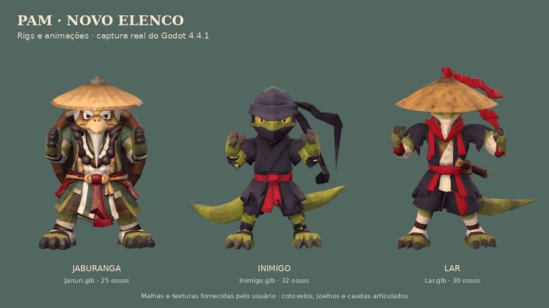

# Rigs dos modelos fornecidos

Os três GLBs recebidos sem esqueleto agora têm skin, cotovelos, joelhos e clipes nativos de animação. São as malhas ativas no prólogo e nos inimigos da fase. `Januri.glb` foi associado ao mestre **Jaburanga**, mantendo o nome canônico da história; **Lar** assume o papel do assassino. As duas variantes de IA dos inimigos comuns usam o mesmo modelo fornecido.



[Vídeo MP4](captures/npcs-rig.mp4) · [Esqueletos no Godot](captures/npc-ossos.png) · [Prólogo](captures/npc-prologo.png) · [Inimigo na trilha](captures/npc-trilha.png).

## Arquivos

| Modelo | GLB pronto para uso | Blender editável | Ossos | Triângulos | Altura no jogo |
|---|---|---|---:|---:|---:|
| Mestre / Januri | [npc_januri_rig.glb](../assets/models/npc_januri_rig.glb) | [januri_rig.blend](../assets/source/npcs/januri_rig.blend) | 25 | 50.004 | 1,80 m |
| Inimigo | [npc_inimigo_rig.glb](../assets/models/npc_inimigo_rig.glb) | [inimigo_rig.blend](../assets/source/npcs/inimigo_rig.blend) | 32 | 50.000 | 1,70 m |
| Lar | [npc_lar_rig.glb](../assets/models/npc_lar_rig.glb) | [lar_rig.blend](../assets/source/npcs/lar_rig.blend) | 30 | 50.000 | 1,90 m |

Os GLBs são independentes, com texturas embutidas. O jogo não precisa de Blender ou plugins. Os `.blend` têm as imagens empacotadas, a malha original e o esqueleto editável. `MotionReference`, oculto nesses arquivos, é apenas o esqueleto autoral usado como referência de movimento; não é exportado. Os originais intactos estão em `assets/source/npcs/*_original.glb`, com hashes registrados nos metadados individuais.

Cada rig tem raiz, quadril, coluna, peito, pescoço, cabeça, clavículas, braços, antebraços, mãos, coxas, canelas, pés e pontas dos pés. O mestre acrescenta ossos para casco, chapéu e barba; o inimigo, duas cadeias de quatro ossos nas caudas e dois nas fitas; Lar, uma cauda de quatro ossos, duas fitas, chapéu e bainha. As duas ramificações de cauda do inimigo já existem no arquivo recebido e foram preservadas.

## Animações e revisão

Os 11 clipes de cada GLB são `Idle`, `Guard`, `Walk`, `Run`, `Windup`, `Attack`, `Hit`, `Defeat`, `Power`, `ElbowFlex` e `KneeFlex`. Os dois últimos isolam a dobra do cotovelo direito e de cada joelho para inspecionar os pesos. Os movimentos foram adaptados de animações autorais do projeto às proporções fornecidas, com pés apoiados, punho direcionado à frente e movimento secundário nas caudas/fitas. O resultado é FK amostrado no Godot; o cálculo de IK usado na autoria foi gravado nos clipes.

Abra **`scenes/npc_rig_review.tscn` e pressione F6**:

| Tecla | Revisão |
|---|---|
| 1 / 2 / 3 | Guarda / andar / correr |
| 4 / 5 | Soco / golpe forte |
| 6 / 7 | Reação / derrota |
| 8 / 9 | Cotovelo / joelhos |
| 0 | T-pose fornecida |
| B / V | Exibir ossos / girar os modelos |
| Espaço / ← → | Pausar / avançar ou voltar um quadro |

Essas teclas pertencem somente à cena de revisão. Na fase continuam **ação J/X** para giro → soco médio → soco forte e **pulo Espaço/A**.

`scripts/npc_animator.gd` carrega a skin e amostra os clipes com pequenas transições. `enemy.gd` conecta patrulha, perseguição, antecipação, ataque, reação e derrota aos clipes. O volume de dano acompanha a mão animada durante o impacto e verifica bloqueio por paredes. `trail.gd` usa os novos modelos no confronto de abertura e a pose de derrota do mestre.

## Preservação e limites

A forma em repouso, as proporções e a contagem de triângulos foram preservadas. Aplicou-se apenas escala uniforme para a altura do jogo e alinhamento dos pés ao chão. UVs e pixels das texturas PBR 4096² foram comparados com os originais: albedo e normal RGB, rugosidade e metalicidade nos canais correspondentes. O exportador do Blender quantiza normais personalizadas; `preserve_normals.py` restaura as normais originais no GLB, copiando também os pesos quando precisa separar vértices. O verificador independente compara os cantos dos triângulos antes e depois, sem exigir os mesmos índices internos.

Os pesos automáticos por calor não resolveram estas malhas: o processo usa reparação determinística por distância aos segmentos e regiões anatômicas, seguida de máscaras para mãos, pés, cabeça e acessórios, com até quatro influências normalizadas por vértice. Os números de vértices reparados estão nos metadados. Casco, chapéus e bainha mantêm volume rígido.

As mãos têm controle pelo punho, **sem ossos individuais para cada dedo**. Não há rig facial, simulação de tecido ou saque da katana: a espada de Lar permanece na bainha, como no modelo recebido. Roupas, ombros e dobras em poses extremas ainda podem exigir pintura manual adicional de pesos; a validação técnica não substitui sua aprovação artística. As malhas de cerca de 50 mil triângulos e texturas 4K foram mantidas; ainda não houve redução/LOD ou perfil em GPU de destino.

## Validação executada

Godot **4.4.1**, Blender **4.3.2** e verificações independentes dos GLBs:

- Importação e execução da cena de revisão; renders reais de guarda, ataque, corrida, articulações, costas, perfil, T-pose e derrota.
- Skin conectada ao Skeleton3D, todos os vértices com pesos válidos, 25/32/30 ossos e os 11 clipes em cada modelo. Cotovelo e ambos os joelhos dobram 90° nos clipes de inspeção; as caudas têm movimento. Acessórios rígidos mantêm escala.
- Reabertura dos três arquivos Blender: ossos, 11 trilhas NLA e as três imagens 4K empacotadas presentes em cada fonte editável.
- Geometria em repouso com erro máximo menor que 0,00000022 unidade após a normalização; UVs iguais e erro de normal menor que 0,000000036. Texturas verificadas por pixel.
- Integração **35/35**; inclui os três modelos ativos, golpe real do inimigo causando dano, prólogo, checkpoint, morte e conclusão.
- Combo de Pam **20/20 em 120 FPS e 20/20 em 30 FPS** nas execuções automatizadas com `--fixed-fps`.
- Travessia integral em ambas as taxas: conclusão, **0 mortes, 6 inimigos derrotados**, checkpoint e portão. São testes automáticos, não avaliação manual de controle.

Logs em `docs/test-logs/npc-*`; relatórios em `docs/captures/npcs-*-verificacao.json`. As capturas de prólogo e trilha usam câmeras preparadas na cena real. O renderizador foi Mesa llvmpipe por software; não houve teste manual com controle nem medição em GPU dedicada. Na importação inicial headless, o renderizador dummy emitiu diagnósticos internos de textura; o render gráfico e as execuções posteriores carregaram os materiais.

## Reproduzir

Para autoria: Blender 4.3.2 com Python/NumPy; verificadores e composição usam Python, NumPy e Pillow. O MP4 usa FFmpeg. Execute a partir da raiz:

```sh
blender -b -t 4 --python-exit-code 1 -P tools/npc/build.py -- januri
blender -b -t 4 --python-exit-code 1 -P tools/npc/build.py -- inimigo
blender -b -t 4 --python-exit-code 1 -P tools/npc/build.py -- lar
python3 tools/npc/verify.py
blender -b -t 4 --python-exit-code 1 -P tools/npc/check_sources.py
./tools/godot.sh --headless --editor --import
./tools/godot.sh --headless --script tools/npc/review.gd -- --validate-only
./tools/godot.sh --headless --fixed-fps 120 --script tests/integration.gd
PAM_REVIEW_SCRIPT=tools/npc/review.gd ./tools/render_review.sh
PAM_REVIEW_SCRIPT=tools/npc/capture_cast.gd ./tools/render_review.sh
python3 tools/npc/compose.py
```

Os renders e relatórios temporários vão para `build/npc_review/`. `PAM_NPC_REVIEW_OUTPUT` permite escolher outra pasta. As fontes originais e as animações autorais já estão no repositório; não há dependência de arquivos comerciais do Crash.
