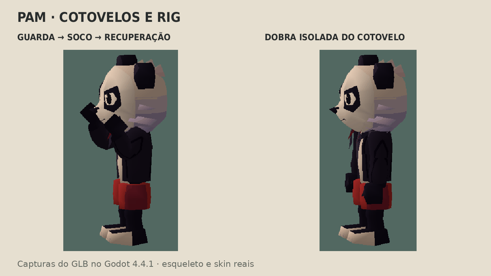
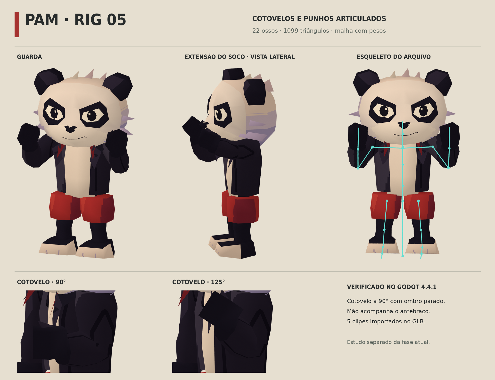

# Pam — rig da revisão 05

A revisão 04 tinha partes girando pelos ombros/quadris, sem cotovelos. A correção substitui esse sistema por **um esqueleto de 22 ossos e uma malha com pesos**. A cabeça e a identidade visual do estudo PS1 foram mantidas; braços e pernas foram reconstruídos para articular.





## Arquivos e articulação

- `assets/models/pam_ps1_rig.glb`: 1.099 triângulos, uma malha, um skin, um material e atlas original 128×128 embutido. Cores por vértice e filtro nearest.
- `assets/source/pam_ps1_rig.blend`: armature editável, grupos de vértices, modificador Armature e ações/NLA.
- `assets/source/pam_ps1_rig_metadata.json`: contagens do GLB e medição da deformação no Blender.
- Hierarquia: raiz, quadril, coluna, peito, pescoço, cabeça; clavícula → braço → antebraço → mão; coxa → canela → pé → ponta do pé, em ambos os lados.
- Mangas contínuas com anéis de suporte no cotovelo, volume de braço/antebraço e punhos mais estreitos. Pesos normalizados, com no máximo dois ossos por vértice. A mão tem osso próprio.
- `Guard`, `Jab`, `Cross`, `Run` e `ElbowFlex` são clipes autorais de desenvolvimento, incluídos no GLB. Guarda e golpes usam cotovelos; `ElbowFlex` demonstra a dobra isolada sem mover o braço superior.

O rig é FK, sem controles IK, dedos individuais ou rig facial. Os clipes são estudos de articulação; antecipação, contato dos pés e refinamento marcial ainda precisam de direção de animação. Os ombros/roupas podem apresentar sobreposição em poses extremas; não são animações finais de combate.

O estudo é separado do `pam.glb` usado pela fase. A integração ao controlador de combate ainda depende da nova avaliação artística e da adaptação do animador procedural, que atualmente procura pivôs rígidos. Esta revisão não altera o gameplay da Fase 1.

## Verificação executada

O gerador verificou pesos normalizados, limite de duas influências, um skin, 22 joints e cinco animações no GLB. A deformação avaliada no Blender moveu os vértices da mão direita em aproximadamente **0,374 unidades do modelo** ao dobrar o cotovelo 90°; não é uma escala física recuperada do PS1.

No **Godot 4.4.1**, o GLB importado gerou um `Skeleton3D`, `MeshInstance3D` com skin e arrays de pesos/ossos, e um `AnimationPlayer` com os cinco clipes. O teste mediu **90,000°** no cotovelo, braço superior parado e deslocamento de **0,291 unidades** na origem do osso da mão. As duas medidas usam pontos distintos: vértices da mão no Blender e origem do osso no Godot.

Foram capturados 68 quadros reais em 640×480 no renderizador OpenGL/llvmpipe: guarda, jab, cross, sequência de soco e sequência lateral de flexão. O GIF usa essas capturas; os renders maiores também carregam o GLB exportado. As linhas verdes da prancha são uma visualização dos ossos importados, deslocadas para a frente para não ficarem ocultas pelo corpo. Sem pintura ou substituição da malha nas imagens.

A importação headless terminou com código 0, registrando o diagnóstico interno `Parameter "t" is null` do renderizador dummy, já descrito na validação da fase. A captura com renderizador gráfico concluiu com `PAM_RIG_GODOT_OK`, sem erro de script. O exportador Blender também registra a indisponibilidade do Draco; o GLB usa geometria sem essa compressão e não depende dela.

Não houve novo teste de gameplay ou teste manual com controle: o modelo ativo da fase não foi trocado. Aprovação artística e qualidade comercial permanecem pendentes.

## Reproduzir

```sh
python3 tools/ps1/paint_atlas.py
blender -b -t 4 -P tools/ps1/model.py
blender -b -t 4 -P tools/ps1/rig.py
./tools/godot.sh --headless --editor --import
blender -b -t 4 -P tools/ps1/render_rig.py
PAM_REVIEW_SCRIPT=tools/ps1/review_rig.gd ./tools/render_review.sh
python3 tools/ps1/compose_rig.py
```

Ferramentas de autoria: Blender 4.3.2, Python/Pillow/NumPy e Godot 4.4.1. Os assets são originais, sem malhas, texturas, animações ou código comercial do Crash. O orçamento de polígonos/ossos é uma escolha deste projeto.
